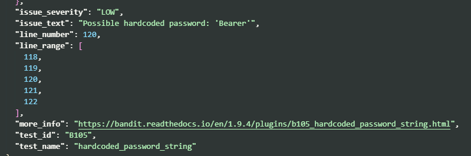
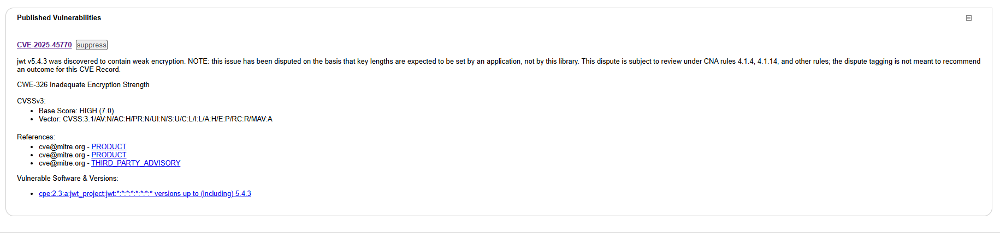
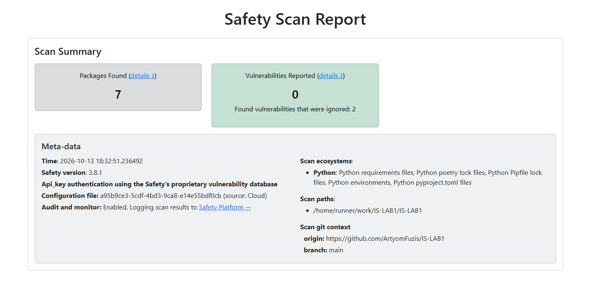
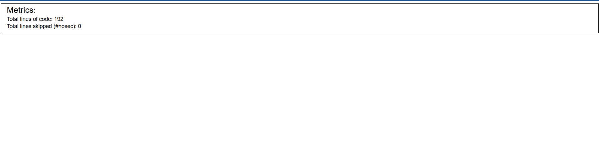
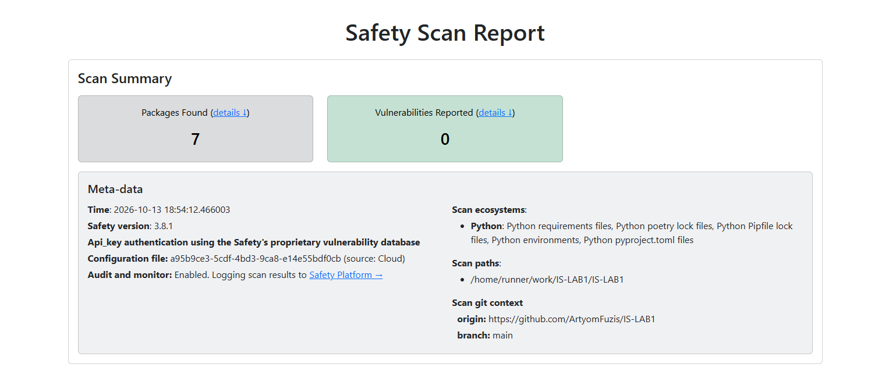
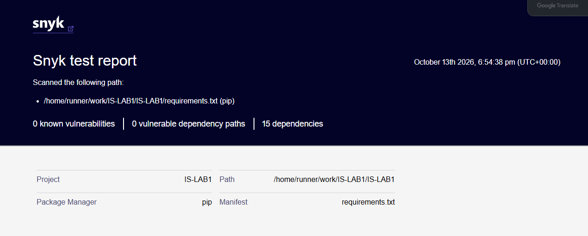
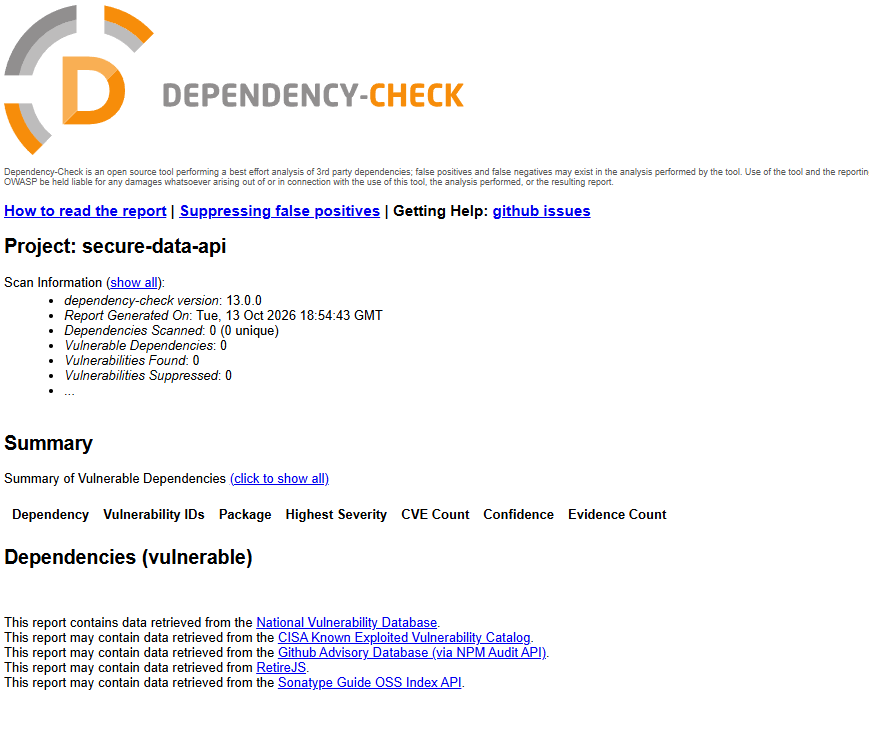

# Информационная безопасность. Работа 1: Разработка защищенного REST API с интеграцией в CI/CD 

Выбраный стек: Python Flask, PostgreSQL, SQLAlchemy. Проверки: bandit, safety, а также OWASP Dependency-Check и Snyk

## Описание проекта

### API
У данного REST API приложения есть три эндпоинта:
1. POST /auth/login - аутентификация пользователя с помощью логина и пароля
2. GET /api/data - получить все объекты data (доступно только для авторизованных пользователей)
3. POST /api/data - создать объект data (доступно только для авторизованных пользователей)

### Примеры запросов
#### POST http://localhost:8000/auth/login 

Тело:
```json
{
    "login": "user",
    "password": "user123456789"
}
```

Ответ: 
```json
{
    "access_token": "<jwt-token>",
    "expires_in": 900,
    "token_type": "Bearer"
}
```

#### GET /api/data

Ответ:
```json
[
    {
        "description": "some_description",
        "extra_fields": "{}",
        "id": 1,
        "name": "test_name"
    },
    {
        "description": "some_description",
        "extra_fields": "{asd}",
        "id": 2,
        "name": "test_name"
    }
]
```

#### POST /api/data

Тело:
```json
{
    "name": "test_name",
    "description": "some_description",
    "extra_fields": "<html></html"
}
```

Ответ: 
```json
{
    "description": "some_description",
    "extra_fields": "&lt;html&gt;&lt;/html",
    "id": 4,
    "name": "test_name"
}
```

### Запуск & Вызов эндпоинтов 
Для запуска приложения необходимо скопировать файл .env.example в файл .env и заполнить его следующими параметрами:
1. APP_PORT - стандартный порт приложения, на который можно будет отправлять запросы
2. POSTGRES_DB - название БД внутри кластера postgres 
3. POSTGRES_USER - имя пользователя в кластере postgres
4. POSTGRES_PASSWORD - пароль пользователя в кластере postgres
5. DEFAULT_USER - имя пользоватея, что будет создан по умолчанию в системе
6. DEFAULT_USER_PASSWORD - пароль  пользоватея, что будет создан по умолчанию в системе
7. JWT_SECRET - сикрет для генерации JWT, должен быть более 32 символов

Далее необходимо выполнить команду для запуска проекта в фоновом режиме 
```bash
docker compose up --build -d 
```

После запуска API будет доступен на `http://localhost:8000`. Кластер PostgreSQL доступен на порту 5433. Автоматической системой миграций Liquibase создаст таблицы `users` и `data`, а также пользователя по умолчанию. Пароль пользователя хранится в кластере БД в виде bcrypt-хэша.

Для того, чтобы сбросить данные тома БД и выключить приложение, необходимо выполнить: `docker compose down -v`. 

## Меры защиты

- **SQL injection:** все обращения к БД выполняются через ORM SQLAlchemy и связанные параметры. Конкатенаций с пользовательскими данными в запросах нет.
- **XSS:** приложение сохраняет исходные строки в PostgreSQL, но при выводе экранирует HTML-спецсимволы в строковых значениях и ключах (с помощью escape). Кроме того явным образом выставляется тип возвращаемого контента `Content-Type: application/json`. 
- **Аутентификация:** пароль пользователя создаётся в миграциях с помощью расширения `pgcrypto`. При входе пароль сравнивается с bcrypt-хэшем, открытый пароль не сохраняется. JWT подписывается HS256, проверяются алгоритм, издатель, аудитория, срок действия и обязательные поля claims. Ошибки входа не раскрывают, существует ли пользователь.
- **Секреты:** пароли БД, пароль пользователя по умолчанию и ключ подписи JWT задаются через `.env`, который исключён из Git. Все сикреты передаются через переменные окружения.

## Пайплайн Github Actions

Workflow `.github/workflows/ci.yml` запускается при кажом пуше в репозиторий/пулл реквесте и вручную. Он выполняет автоформатирование, а также сканированние чере bandit, safety, а также OWASP Dependency-Check и Snyk. Отчёты сохраняются как артефакт пайплана `security-reports`.

Для запуска Safety и Snyk требуются API токены, которые были добавлены в сикреты репозитория (`Settings → Secrets and variables → Actions`). 

## Результаты сканирования 

Первый запуск пайплайна (https://github.com/ArtyomFuzis/IS-LAB1/actions/runs/38439835332) упал с ошибками:

Один ворнинг от bandit:



И критикал от OWASP Dependency-Check:



Оба срабатывания были ложными. Bandit подумал что строка "Bearer" может быть захардкоженным паролем, хотя по факту это константа.

Фикс: вынести фактически данную строку как константу

OWASP неправильно сопаставил факты и спутал библиотеку библиотеку python: PyJWT и библиотеку jwt для языка программирования php.

Фикс: отключить параметр для использования экспериментальной базы уязвимостей OWASP

После, в одном из запусков пайплайна возникло предупреждение от Safety 



Фикс: отключить на сайте safety ограничения по codebase на игнор файлов и скип ошибок.

В итоге, все четыре сканера не видят каких-либо проблем:







